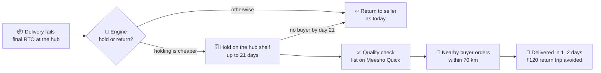
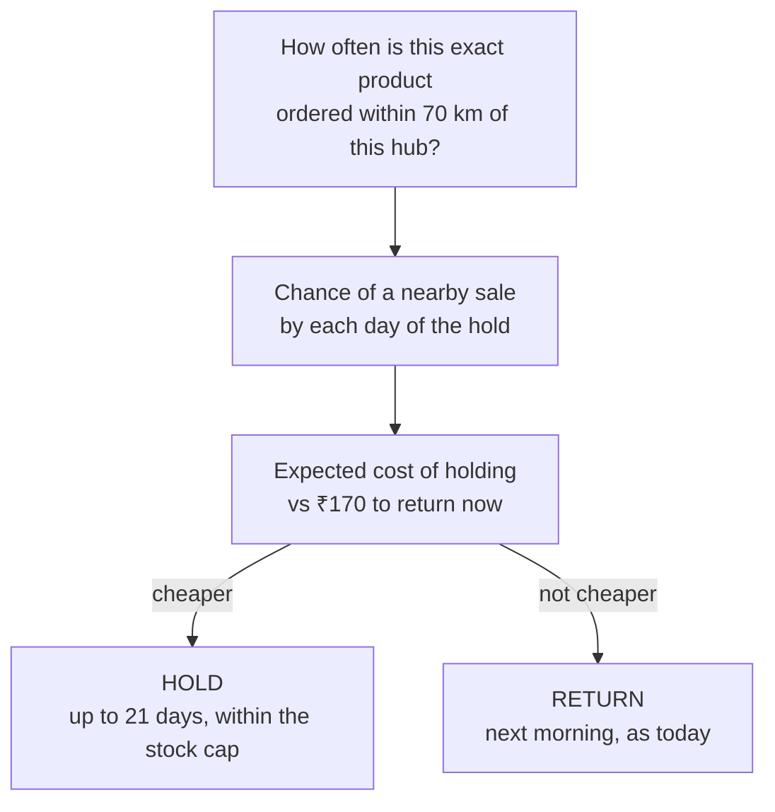

<div align="center">

# Valmo-SAVE

### Every RTO gets one last chance to become a sale

**Team 52 Saints · IIT Kharagpur · Meesho DICE Challenge 3.0 · Problem statement: _Reducing RTO_**

<br/>

[](https://valmo-save-lmdc.vercel.app/rto)
&nbsp;
[](https://meesho-quick-app.vercel.app/)
&nbsp;
[](https://meesho-save-hq.vercel.app/?loc=r%3Ancr)

</div>

| Live prototype | Who uses it | Link | Video |
|---|---|---|---|
| 🏭 **LMDC Dashboard** | The team at a Valmo delivery hub | [valmo-save-lmdc.vercel.app/rto](https://valmo-save-lmdc.vercel.app/rto) | [Walkthrough](Valmo-SAVE%20Prototype%20Walkthrough.mp4) |
| 🛍️ **Meesho Quick** | Customers | [meesho-quick-app.vercel.app](https://meesho-quick-app.vercel.app/) | [44-sec walkthrough](Meesho_Quick_Walkthrough.mp4) |
| 📊 **Performance Tracker** | Meesho managers | [meesho-save-hq.vercel.app](https://meesho-save-hq.vercel.app/?loc=r%3Ancr) | [42-sec walkthrough](Performance%20Tracker_Walkthrough.mp4) |

> 💡 Open **Meesho Quick** on a phone, or in Chrome press <kbd>F12</kbd> and switch to phone view.

---

## In 30 seconds

- 📦 **The problem.** A failed Meesho delivery (an **RTO**) travels all the way back to the seller. That costs about **₹170** per parcel (₹50 forward, already spent, plus ₹120 back) and earns nothing.
- 💡 **Our idea.** The parcel has already reached the buyer's city. So instead of sending it back, we **hold it at the local delivery hub for up to 21 days** and **sell it to the next buyer within 70 km** who orders the same product.
- 🧠 **The model.** For every RTO, a demand model predicts the chance of a nearby sale and **holds the parcel only when that is cheaper than returning it**.
- 💰 **The result.** Each local resale saves **₹87**. We break even when just **27.5 of every 100** held units sell; our back-test resold **48%**.
- 🛠️ **What we built.** A model on ~100k real orders, plus **three working prototypes**: one for the hub, one for the customer and one for Meesho's managers.

---

## 1 · The problem

When an order can't be delivered (the buyer isn't home, refuses the parcel, or the address is wrong), it becomes an **RTO: return to origin**.

| Today, for every RTO | Cost |
|---|---|
| Forward delivery (already spent) | ₹50 |
| Return trip to the seller | ₹120 |
| **Total lost** | **₹170** |

The seller's stock and cash stay locked for weeks. And often, a few days later, **someone a few kilometres from the same hub orders the very same product**.

> *"My product reached the customer in 7 days. Then it stayed in the return cycle for another 17 days."*
> — Prakash Chand, seller, Shri Prakash Shoes, Varanasi

## 2 · What we found

| Source | What we did | What it told us |
|---|---|---|
| 🗣️ **Primary survey** | **146 responses**: 137 customers + 9 stakeholders (sellers, delivery partners, hub staff) | Refusal, not being available and address problems cause most failures; sellers suffer from locked stock and cash |
| 🧑‍🏫 **Meesho mentor sessions** | Discussed RTO policy and hub operations | RTOs not back with the seller within **45 days** count as lost; hubs can **already re-pack and re-label**; vehicles **already run between hubs** |
| 🧑‍💼 **Industry experts** | Logistics, fintech and fraud specialists | Route efficiency, RTO prediction and fraud signals are proven capabilities to build on |
| 📊 **Data** | ~100k real orders from the public **Olist** e-commerce dataset (Brazil) | Demand for top products is **local and repeats**: 63% of top-product orders around São Paulo are within 25 km, and 77% within 50 km |

## 3 · Our approach: stop RTO at every stage, then save what still fails

We looked at the whole order journey. The deck covers ideas for every stage:

| Stage | Idea | In short |
|---|---|---|
| **Prevent** | Try-on, size guidance, real buyer photos | Help buyers choose right the first time |
| **Commit** | Confirm intent before dispatch | A quick WhatsApp check before shipping risky orders |
| **Rescue** | Smarter failed-delivery recovery + an **Attempt Integrity Score** for riders | Reward genuine delivery attempts and recover failed ones |
| **Recover** ⭐ | **Valmo-SAVE** (our main solution) | When an order still becomes a final RTO, give it one more chance to sell |

Some failures will always happen. **Valmo-SAVE starts where every other fix stops**, and it is the focus of this repository.

## 4 · Valmo-SAVE: how it works



Three steps:

1. **Retain.** Keep the eligible parcel at the destination hub (LMDC) as temporary stock. The seller still owns it; the hub only looks after it.
2. **Match.** Watch for a new order of the **same product, same seller, same size** from a buyer within 70 km.
3. **Fulfil.** Re-label it and deliver it as a fresh sale, using vehicles that **already run between hubs every day**.

> **Example.** A kurta fails delivery at Delhi South. Two days later, a buyer in Gurgaon Sector 22, **14 km away**, orders the same kurta. It arrives the next day: no ₹120 return trip, and a sale saved.

**Guard-rails:** hubs never become warehouses (a 21-day limit and a stock cap per product), sellers opt in, and fragile or perishable products are excluded.

## 5 · The model: hold only when the economics work

For every RTO, the engine asks one question: **is holding this parcel cheaper than sending it back?**



| Step | What the model does |
|---|---|
| **1. Local demand** | Estimates daily demand (λ) for the product within 70 km, weighting recent weeks most. Products with few sales borrow their category's rate. |
| **2. Chance of resale** | Demand is bursty, so it uses a **negative-binomial** model: `P(sold by day t) = 1 − (1 + λt/k)^(−k)` |
| **3. Expected cost** | `E[cost](T) = ₹50 + ₹25 + ₹0.33 × days held + ₹120 × (1 − P(sold by T))` |
| **4. Decision** | **Hold** if the cheapest hold of up to 21 days costs less than **₹170**; otherwise **return** |
| **5. Stock cap** | The n-th unit of a product is held only if the chance of n nearby orders still pays |
| **6. Hard stop** | Every parcel waits at most **min(21 days, its remaining 45-day room)** |

### Where 70 km and 21 days come from

Both are the point of diminishing returns in our back-test, found three independent ways and rounded up:

| Method | Resale radius | Holding cap |
|---|---|---|
| All products, all regions | 65 km | 20.5 days |
| Top-20 products | 70 km | 14.6 days |
| São Paulo metro (densest market) | 45 km | 17.6 days |
| **Final rule** | **70 km** | **21 days** |

- **70 km:** 89% of the value is already captured at 70 km. Beyond that, buyers are in other cities and freight jumps about 43%.
- **21 days:** holding pays from **day 2**, there is a **50% chance of a sale by day 8**, and **70% by day 21**.

### Back-test results (on months the model never saw)

| Test set | RTOs | Result |
|---|---|---|
| Dense metros | 8,351 | **₹9.81 saved per RTO**; **48%** of held units resold |
| All of Brazil | 26,767 | ₹3.54 saved per RTO |

The engine is also honest: for **64% of metro RTOs** it says a nearby buyer is unlikely, and returns them as usual.

## 6 · The money

| Per unit | Returned as today | Held and **resold** (SAVE) | Held, **not** resold |
|---|---|---|---|
| Forward delivery (already spent) | ₹50 | ₹50 | ₹50 |
| Holding, QC and relisting (up to 21 days) | – | ₹33 | ₹33 |
| Move between hubs (existing vehicles) | – | ₹0 | ₹0 |
| Return trip | ₹120 | **₹0 (avoided)** | ₹120 |
| **Total** | **₹170** | **₹83 → saves ₹87** | ₹203 (₹33 more) |

- ⚖️ **Break-even: 27.5% of held units must resell.** The back-test achieved 48%.
- 🏙️ **Delhi NCR pilot:** 10,000 RTOs in 3 months, 70% eligible, 50% resold → about **₹1.89 lakh net saving**.
- 🛡️ **Stress-tested:** even with ₹10 extra cost per move, break-even is still only 36%. A shorter hold makes break-even easier (22.5% at 3 days).

Full workings: [`FINANCIAL MODEL_VALMO SAVE_ROUND 2.xlsx`](FINANCIAL%20MODEL_VALMO%20SAVE_ROUND%202.xlsx)

## 7 · Meesho Quick: where saved stock gets sold

Held units are sold through **Meesho Quick**, a new section of the Meesho app: *"Same products. Near you. Get it in 1–2 days."*

- ⚡ **Faster delivery:** 1–2 days from a hub nearby, versus 5–7 days from the seller.
- 💳 **More prepaid orders:** fast delivery nudges buyers to pay online, which cuts refusals at the door.
- 🏷️ **Same product, same price:** no discounting, so the seller's brand and margins are protected.
- 🌱 **A new growth vertical:** as local stock grows, Quick can become a dedicated fast-delivery section, much like the ₹9 store drives traffic.

## 8 · Three working prototypes

One connected flow: **the hub decides → the customer buys → Meesho monitors.**

### 🏭 [LMDC Dashboard](https://valmo-save-lmdc.vercel.app/rto): for the hub team · [code](LMDC%20Dashboard)

- A **Retain / Return** decision for every failed delivery, with the reason in plain words.
- The hold shelf with a 21-day countdown, and dispatch of resold units to the next shuttle.
- Today in numbers: 602 failed → 214 retained, 388 returned, about 103 expected resales.

### 🛍️ [Meesho Quick](https://meesho-quick-app.vercel.app/): for the customer · [code](Meesho%20Quick%20App)

- Home banner → **Available near you** → product → checkout → live tracking, styled like the screens in our deck.
- Placing an order **reserves the exact unit**, so it can never be sold twice.
- A `/hub` page where the hub team retains a unit, quality-checks it and packs orders.
- Cash on delivery or a clearly labelled **simulated** online payment.

### 📊 [Performance Tracker](https://meesho-save-hq.vercel.app/?loc=r%3Ancr): for Meesho managers · [code](Performance%20Tracker)

- **Select** any of 14 LMDCs, a city or All India, and any date range.
- **Monitor** the funnel (RTO received → eligible → listed on Quick → sold), sell-through, delivery time, prepaid share and cost saved.
- **Act** on alerts: ageing stock, low sell-through, QC problems, slow delivery.

> Each prototype folder has its own README with screens, routes and setup.

## 9 · Pilot plan: start with Delhi, then scale

| Days | Phase | What happens |
|---|---|---|
| **0–30** | Set up | Pick 2–3 high-RTO hubs in Delhi NCR, align delivery partners, set up QC and tagging, deploy the dashboards |
| **31–60** | Pilot | Decide hold or return for live RTOs, auto-list held units on Meesho Quick, and track sell-through, delivery time, prepaid share and cost saved |
| **61–90** | Prove and prepare | Check results against targets, tune rules per product, and write the playbook for Mumbai, Bengaluru and Hyderabad |

**Everyone wins:** the seller sells sooner at full price, the buyer gets it in 1–2 days, the hub avoids return trips, and Meesho saves money and gains a fast-delivery vertical.

## 10 · What's in this repository

| File / folder | What it is |
|---|---|
| 📓 [`Prediction_Model.ipynb`](Prediction_Model.ipynb) | The full pipeline: merging the 9 Olist tables, local demand maps, the hold / return engine, the back-test, and the radius and holding-time analysis |
| 🗂️ [`Olist (Brazillian ECom Marketplace)_DataSets/`](Olist%20%28Brazillian%20ECom%20Marketplace%29_DataSets) | The public dataset (~100k orders, 9 tables) used as a stand-in for Meesho data |
| 📐 [`CALCULATIONS (RADIUS & DAYS)_VALMO SAVE_ROUND 2.xlsx`](CALCULATIONS%20%28RADIUS%20%26%20DAYS%29_VALMO%20SAVE_ROUND%202.xlsx) | Step-by-step workings for the 70 km radius and the 21-day cap |
| 💰 [`FINANCIAL MODEL_VALMO SAVE_ROUND 2.xlsx`](FINANCIAL%20MODEL_VALMO%20SAVE_ROUND%202.xlsx) | Unit economics, break-even and sensitivity |
| 🗣️ [`Survey Response Sheet Valmo.xlsx`](Survey%20Response%20Sheet%20Valmo.xlsx) | 146 survey responses (137 customers + 9 stakeholders) |
| 🏭 [`LMDC Dashboard/`](LMDC%20Dashboard) | Source code: hub dashboard (React + Vite) |
| 🛍️ [`Meesho Quick App/`](Meesho%20Quick%20App) | Source code: customer app (React + Vite) |
| 📊 [`Performance Tracker/`](Performance%20Tracker) | Source code: dashboard for Meesho managers (React + Vite) |
| 🎬 [`Valmo-SAVE Prototype Walkthrough.mp4`](Valmo-SAVE%20Prototype%20Walkthrough.mp4) | Walkthrough of the LMDC dashboard |
| 🎬 [`Meesho_Quick_Walkthrough.mp4`](Meesho_Quick_Walkthrough.mp4) | Walkthrough of the Meesho Quick app |
| 🎬 [`Performance Tracker_Walkthrough.mp4`](Performance%20Tracker_Walkthrough.mp4) | Walkthrough of the Performance Tracker |

## 11 · Run it yourself

**The model.** Open `Prediction_Model.ipynb` in Jupyter or Google Colab, keep the Olist CSVs in their folder, and run all cells (Python 3 with pandas, NumPy, SciPy and scikit-learn).

**Any prototype.** You need Node.js 18 or later:

```bash
cd "Meesho Quick App"        # or "LMDC Dashboard" or "Performance Tracker"
npm install
npm run dev                  # open http://localhost:5173
```

**Deploy your own.** Import this repository into [Vercel](https://vercel.com/new) once per prototype and set **Root Directory** to that prototype's folder. No environment variables are needed.

## 12 · Assumptions and limitations

- **Olist (Brazil) data stands in for Meesho**, so absolute savings will differ; the method carries over unchanged and would be re-run on Meesho's own orders for the pilot.
- **Costs:** ₹50 forward and ₹120 reverse come from the case pack. Holding costs (₹30–33) are built from public storage, handling and wage benchmarks.
- **Distances** are straight-line; road distances are typically 20–30% longer.
- **Moving between hubs** within 70 km is assumed to ride existing vehicle runs at no extra cost (see the sensitivity figures above if it doesn't).
- **The prototypes use simulated or illustrative data**, and payments are simulated. The 21-day hold is a pilot setting, to be tuned per product with real sell-through data.

---

<div align="center">

**Team 52 Saints** · Priyanshu Raj · Bhawesh Kukreja · Dhruv Anil Rai

IIT Kharagpur · Meesho DICE Challenge 3.0

</div>
